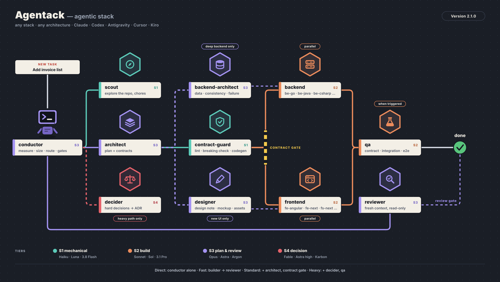

# agentack — agentic stack

**A manager-led, multi-model agent workflow for [Claude Code](https://docs.claude.com/en/docs/claude-code), built for contract-first modular monoliths.**

agentack turns your main Claude Code session into a *manager* that classifies each task,
routes it to the right specialist subagent on the right Claude model, and enforces two
gates: **no build before the contract is checked** and **no "done" before an independent review**.

<p align="center">
  
</p>

Stacks covered out of the box: **Next.js · Angular · Node.js (TypeScript) · Go**.

> 🇹🇷 Türkçe: [README.tr.md](README.tr.md)

---

## Why

A single agent doing everything on one model has two problems: it's expensive for simple work
and it grades its own homework. agentack splits the work the way a real team would:

- **Cheap models for mechanical work**, strong models for planning and review, the strongest
  model only for decisions that are expensive to undo.
- **The contract is the source of truth.** OpenAPI / AsyncAPI is written and validated first;
  frontend and backend are built in parallel against generated types.
- **Module boundaries are enforced**, not just documented.
- **The author never approves its own work.** Review runs in a fresh context with read-only tools.

## The crew

```
Main session (Opus) = MANAGER   ← skills/agentack/SKILL.md
 ├── scout           Haiku    repo exploration, mechanical edits
 ├── architect       Opus     feature plan, contracts, ADRs
 ├── contract-guard  Haiku    lint, breaking-change check, codegen
 ├── be-go           Sonnet   Go module implementation
 ├── be-node         Sonnet   Node/TypeScript module implementation
 ├── fe-next         Sonnet   Next.js (App Router)
 ├── fe-angular      Sonnet   Angular (standalone + signals)
 ├── qa              Sonnet   contract, integration and e2e tests
 ├── reviewer        Opus     fresh-context, read-only review
 └── decider         Fable    hard, costly-to-reverse decisions only
```

The manager is the main session itself, not a subagent. In Claude Code only the main session can
spawn subagents, so the workflow owner has to live there. The manager doesn't write code; it
delegates, tracks state and runs the gates.

## Flow

```
classify ─► (decide) ─► plan + contract ─► contract gate ─► parallel build ─► test ─► review ─► merge
```

Each task is tagged on four axes: **size** (S/M/L), **contract impact** (none / additive / breaking),
**layers** (fe-next, fe-angular, be-go, be-node, db, event) and **risk** (normal / high). The tags pick the path:

| Path | When | Agents |
|---|---|---|
| **Fast** | S, no contract change, normal risk | builder → reviewer |
| **Standard** | M | architect → contract-guard → builders (parallel) → qa → reviewer |
| **Heavy** | L, high risk, or breaking contract | decider → architect → contract-guard → builders → qa → reviewer |

**Escalation:** if an agent fails the same task twice, the manager moves it up one tier
(Haiku → Sonnet → Opus → Fable) and includes the previous attempts in the brief.

See [`skills/agentack/references/routing.md`](skills/agentack/references/routing.md) for the full routing table.

## Requirements

- Claude Code with skills and subagents support
- Access to the Claude models used: Opus, Sonnet, Haiku, and optionally Fable (see [Customizing](#customizing))
- Your project in a **git** repository (parallel builders use worktrees)
- `bash` for the installer (macOS, Linux, WSL)

## Install

```bash
git clone https://github.com/OWNER/agentack.git ~/agentack   # or: git@github.com:OWNER/agentack.git
~/agentack/install.sh
```

Without git: download the ZIP from the GitHub page (**Code → Download ZIP**) or a release,
unzip it and run `./install.sh` inside the folder. Want to customize it? Fork the repo and
clone your fork instead.

This copies the skill to `~/.claude/skills/agentack` and the agents to `~/.claude/agents/`.
Existing files with the same names are backed up to `~/.claude/backups/` first.

Set the main session to Opus, either with `"model": "opus"` in `~/.claude/settings.json`
or per session with `/model opus`.

**Update:** `cd ~/agentack && git pull && ./install.sh`
**Uninstall:** `~/agentack/install.sh --uninstall`

## Usage

agentack is **opt-in**. It only runs when you call `/agentack`, and stays out of every other project.

**1. First time in a project**, let the manager write your project's `CLAUDE.md`:

```
/agentack Scan this repo and create CLAUDE.md from the project-CLAUDE.md template.
List any missing contract tooling (lint, breaking check, codegen, mock server).
```

The project `CLAUDE.md` tells agentack which apps and modules exist and which commands to run.
Project rules always override the skill's defaults.

**2. Then just give it work:**

```
/agentack Add an invoice list endpoint to the billing module and a list page in the Next.js app
```

The manager will classify the task, show you the plan, run the contract gate, build in parallel,
test, review and report back. It commits or opens a PR only if you ask.

## Architecture conventions

agentack assumes (and helps enforce) a **contract-first modular monolith**:

- **Module = bounded context.** Each module owns its data; no cross-module table access.
- **Narrow public surface.** Other modules may import only a module's `api` package / public barrel.
- **Cross-module communication** goes through public interfaces (sync) or domain events with a
  transactional outbox (async). No cycles.
- **Contracts live in `contracts/<module>/`**: OpenAPI 3.1 for HTTP, AsyncAPI 3 for events,
  RFC 9457 Problem Details for errors.
- **Generated code is never edited by hand.** Breaking changes are detected with `oasdiff`
  and require a new version plus your approval.

Default tooling (replace it in your project `CLAUDE.md` if you use something else):

| Concern | Tool |
|---|---|
| Contract lint | Redocly CLI / Spectral |
| Breaking changes | oasdiff |
| Mock server | Prism |
| Go server stubs | oapi-codegen (strict server) |
| Node types & validation | openapi-typescript + zod |
| Next.js / Angular clients | orval (or openapi-fetch / ng-openapi-gen) |
| Contract tests | Schemathesis |
| E2E | Playwright |
| Boundaries | go-arch-lint / depguard, dependency-cruiser / eslint-plugin-boundaries / Nx |

Details: [`architecture.md`](skills/agentack/references/architecture.md) ·
[`contracts.md`](skills/agentack/references/contracts.md)

## Repository layout

```
agentack/
├── install.sh
├── agents/                       # subagent definitions (model in frontmatter)
│   ├── scout.md  architect.md  contract-guard.md
│   ├── be-go.md  be-node.md  fe-next.md  fe-angular.md
│   └── qa.md  reviewer.md  decider.md
└── skills/agentack/
    ├── SKILL.md                  # the manager
    ├── references/               # architecture, contracts, routing
    └── templates/                # plan, ADR, task brief, project CLAUDE.md
```

## Customizing

- **Change a model:** edit the `model:` field in `agents/<name>.md`. `decider` uses
  `claude-fable-5-1`; if your account doesn't have Fable, set it to `opus`.
- **Add a stack:** copy a builder (e.g. `agents/be-node.md`), adjust its rules, and add it to the
  crew table and routing rules in `SKILL.md`.
- **Change project conventions:** prefer your project's `CLAUDE.md` over editing the skill, so
  the skill stays generic.
- Always edit the repo, not the installed copy in `~/.claude`. The next install overwrites it.

## Language

The agent prompts are currently written in **Turkish** (technical terms in English). The models
follow them fine regardless of the language you work in, but English translations of the prompts
are a very welcome contribution.

## Contributing

Issues and pull requests are welcome. See [CONTRIBUTING.md](CONTRIBUTING.md).

## License

[MIT](LICENSE)

---

agentack is a community project and is not affiliated with or endorsed by Anthropic.
